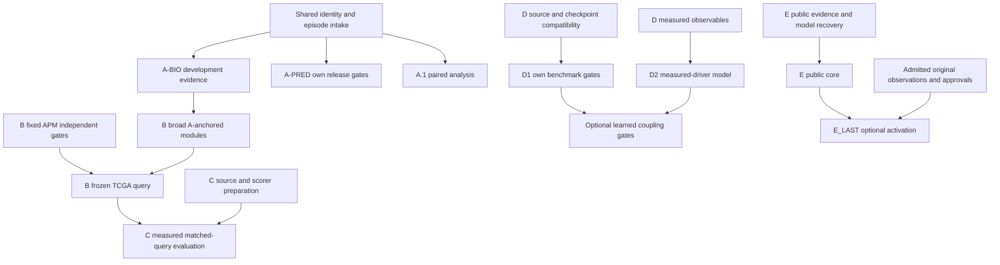

# Dependency-aware restart

Arrows denote scientific dependencies, not permission to start production. E has no dependency on D or original experiments. A.1 does not wait for B/C. A-P2 final-test availability does not block properly frozen development evidence. Measured D2 does not wait for STATE superiority. Only one production paper runs at once; no live job is interrupted.
