# Agentic search architecture

## Governance

Search agents are **read-only**. They produce structured candidate packets and never edit the shared canonical registries. One accountable integrator performs schema validation, conflict resolution and canonical merges. One reviewer independently checks scientific claims and source locators.

No packet is accepted without a source locator. `UNKNOWN` is a valid value; unsupported inference is not.

## Lanes

### Lane A — catalogue resolution

Sources: ICBatlas, TIGER, IOhub, Cancer-Immu, current and historical queues. Resolve labels to original studies, publications, accessions and suspected aliases.

### Lane B — publication and supplement search

Recover treatment, assessment criteria, patient counts, biopsy schedule, source identifiers, exclusions, corrections and publication-family relationships.

### Lane C — repository-object discovery

Locate exact processed objects, versions, filenames, units, transforms, header examples, crosswalks, access terms and retrieval status.

### Lane D — longitudinal ICI studies

Recover pairable patient counts, exact windows, repeat-biopsy selection, missing-follow-up mechanisms, treatment changes and branch suitability.

### Lane E — paired/orthogonal multi-omics

Recover modality-specific denominators and explicit same-patient, same-time and same-specimen links.

### Lane F — overlap and prior exposure

Trace reused cohorts, publication subsets, repository mirrors, atlas derivations, signature training, prior feature selection and model evaluation.

### Lane G — controlled-access feasibility

Record application, authorization, timeline, terms, processed-data availability and whether access is necessary or optional. Never bypass controls.

## Candidate packet contract

Each agent returns one JSON object per lead with:

```text
packet_id
lane
query_ids
candidate_label
proposed_study_id
publication_family_candidates
source_object_candidates
cancer and disease state
treatment and timing
endpoint evidence
modality and platform
identity evidence
suspected overlap
access and redistribution evidence
verified facts
inferences
design implications
unknowns
source locators
recommended next action
agent identity and timestamp
```

The packet is compatible with `source_record.schema.json` where an exact object is resolved and with the TSV registries after integrator review.

## Integrator merge

The integrator:

1. validates packet structure;
2. rejects claims without source locators;
3. searches existing aliases before creating IDs;
4. preserves conflicting evidence as separate assertions;
5. records merge decisions and reviewer;
6. writes canonical registries atomically;
7. never lets an agent-assigned branch status become admission without V0–V7 evaluation.

## Conflict policy

- Original clinical publication/supplement outranks atlas recoding.
- Exact repository object metadata outranks a landing-page summary.
- Later correction/erratum modifies but does not erase prior evidence.
- Two unresolved claims remain conflicting; no majority vote converts them into fact.
- Patient linkage requires explicit evidence; similar names alone cannot merge patients.

## Context control

Agents return compact packets, not full papers or matrices. Large supplements and object inventories are stored outside the root context with stable locators and hashes.

## Source discovery and admission

```mermaid
flowchart LR
    A[Catalogue or publication lead] --> B[Original study and publication family]
    B --> C[Exact source object]
    C --> D[Patient and specimen identity]
    D --> E[Endpoint, treatment, timing and assay validation]
    E --> F[Overlap and prior-exposure audit]
    F --> G[Branch-specific admission receipt]
    G --> H[Materialized patient matrix]
    H --> I[Validation receipt and split freeze]
```


