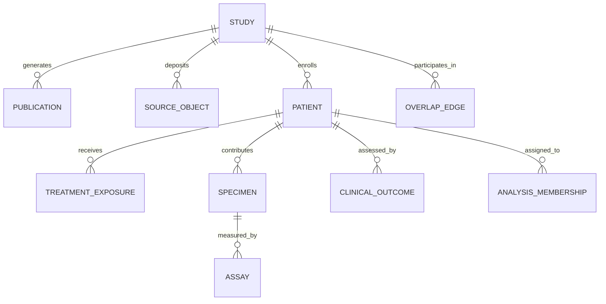
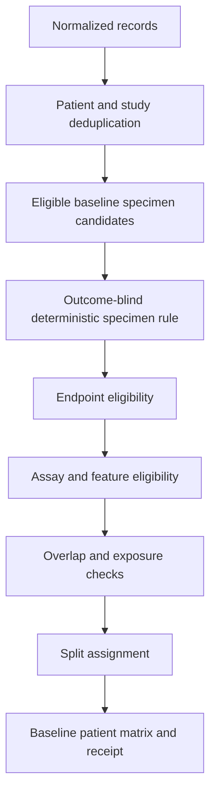
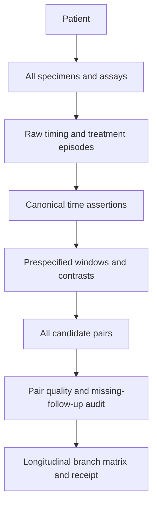

# Paper A + A.1 Data Acquisition and Validation  
## Phase 1 acquisition-state appraisal, implementation reconciliation, architecture, normalized model, validation gates and approval decisions

**Thesis:** *Epigenetic Priming for Enhanced Immunotherapy: A Multi-Omics Strategy to Sensitise Prostate Cancer to Immune Checkpoint Blockade*  
**Evidence freeze:** 2026-10-12; approved defaults recorded 2026-10-15  
**Document status:** Approved appraisal baseline; specification review package, not implementation  
**Primary repository inspected:** `OASolliman590/Master-Thesis-`  
**Primary default branch/commit inspected:** `main` at `a8278c776da7c6b096cc14139d729979db286b50`  
**Historical implementation repository inspected:** `OASolliman590/epigenetic-ici-priming-thesis`, `main` at `96c16794bafc8946ae9f0bdcef81d5f3a599542b`  
**NMRbox archive inspected:** `reference/legacy_nmrbox_20260911/`  
**Proposed future package:** `specs/A_DATA_ACQUISITION_VALIDATION/`

> No cohort was admitted, no source object was downloaded in this appraisal, no patient-level registry or matrix was generated, no split was assigned, no biological analysis was run, no repository branch was created and no pull request was opened. File hashes are reported only where an inspected repository object already supplied them. All other hashes remain `UNKNOWN` until actual retrieval.

---

> **Approval disposition, 15 October 2026:** defaults D01–D10 were approved. The standalone Spec Kit now implements the approved design documents, schemas, templates and tickets. Section 22 is retained as the historical handoff plan; source adapters, populated registries, matrices and scientific release remain unimplemented.

## 0. Evidence-state vocabulary

This appraisal separates four kinds of statement:

| State | Meaning |
|---|---|
| **VERIFIED** | Directly supported by an inspected repository object, Project document, official repository record or original publication. |
| **INFERENCE** | A reasoned conclusion from verified evidence; the supporting facts are stated and the inference is labelled. |
| **DESIGN CHOICE** | A proposed rule or architecture that is not a historical fact. |
| **UNKNOWN** | Evidence is insufficient, unavailable or not yet reconciled. The resolution route is specified. |

A source can be well resolved for one branch and unresolved for another. For example, a study can be suitable for a pretreatment ORR branch but unsuitable for a longitudinal progression branch. No global `usable=yes` field is acceptable.

---

# 1. Executive verdict

## 1.1 Overall state

The project is **design-rich but released-data-product-empty for Paper A/A.1 acquisition**.

The current repository contains a serious Paper A specification, source-admission research notes, a 77-reference candidate queue, a source-only NMRbox recovery and an unmerged evidence-expansion proposal. It does **not** contain a populated authoritative study registry, publication-family registry, source-object registry, patient/specimen/assay registry, branch admission receipts, materialized Paper A matrices, frozen development/final-test assignments or an end-to-end Paper A acquisition CLI.

The correct present readiness is therefore:

- **source-universe readiness:** mixed `R0–R2`;
- **source-specific identity/endpoint evidence:** some individual candidates reach provisional `R3–R4`;
- **branch admission:** `R4` at best, because no `R5` admission receipt exists;
- **matrix readiness:** no released `R6` product;
- **split/final-test readiness:** no released `R8` product;
- **scientific-analysis release:** no `R9` product.

Synthetic tests or a successful parser would not change those scientific readiness statements.

## 1.2 Protocol reconciliation at a glance

The proposal states “approximately 200 patient samples across six cohorts” while listing seven accession strings. This is not necessarily seven independent cohorts: `GSE91061` and `SRP094781` are the GEO and SRA representations of the same Riaz/CA209-038 study. The seven named accession strings can therefore be provisionally reconciled to six originating study families. The phrase “approximately 200 patient samples” remains an original planning estimate, not a verified patient denominator. It must not be forced during implementation.

The protocol source list is scientifically salvageable, but each accession requires reclassification:

- some are strong pretreatment ORR candidates;
- some are longitudinal candidates;
- some have endpoint limitations;
- one contains repeat sequencing;
- some have multiple specimens per patient;
- some represent the same study in multiple repositories;
- RNA and methylation denominators are not automatically paired denominators.

## 1.3 Baseline Paper A

A defensible pretreatment population appears **feasible**, but it is not yet reconstructable from a released canonical registry. Riaz, Hugo, Rose and Cho are plausible source families for different baseline roles, subject to full source-object retrieval, patient/specimen mapping, endpoint verification, assay validation and exposure auditing. GSE135222 cannot be treated as objective response merely because it is an ICI-treated transcriptomic cohort if its patient-level endpoint route supports only survival/progression information. GSE115821 remains a candidate until its publication family, sample episodes, response mapping and repeated-sequencing structure are resolved.

No development set, outer validation set or untouched final test is currently frozen.

## 1.4 Paper A.1

A.1 is **partly feasible as a source-development programme**, not yet as a released meta-analysis.

Riaz/GSE91061 is the clearest protocol-named longitudinal lead because the official series contains pre- and on-treatment material. It still requires exact pair construction, prior-ipilimumab stratification, treatment-relative timing, multiple-biopsy handling and missing-follow-up characterization. GSE115821 contains repeated dated samples and is a longitudinal lead, but its patient/episode structure must be reconstructed rather than inferred from row order. Other expanded sources may add longitudinal evidence, but no validated multi-study pair matrix exists.

Current evidence is insufficient to promise all A.1 branches:

- `A1_ON_R_NR`: plausible;
- `A1_POST_R_NR`: unresolved;
- `A1_RESPONSE_TIME_INTERACTION`: plausible only after at least two independently admitted study families;
- `A1_PROGRESSION`: unresolved;
- `A1_ARM_TIME_INTERACTION`: blocked unless actual comparative arms and arm-specific longitudinal sampling are verified;
- pharmacological-context network meta-analysis: not justified by the current source inventory.

## 1.5 Paired multi-omics

The Cho SuperSeries provides 16 RNA samples and 18 methylation samples in linked series, but the exact same-patient, same-timepoint and same-specimen intersection is not yet a verified paired denominator. Other RNA–methylation leads are also candidates only. Paired multi-omics is therefore not analysis-ready.

## 1.6 Final-test feasibility

An **untouched final test is currently blocked**. The obvious historical cohorts have been inspected in the old pipeline, source-admission work, published atlases, prior predictor literature or the current candidate queue. A source can still be useful as external validation, but “external” must not be used as a synonym for “untouched.” A new final-test source must be selected under a prospective exposure policy before outcome or expression-performance inspection. If this cannot be achieved, the strongest honest label is “previously inspected external validation,” not “untouched final test.”

## 1.7 Historical-code verdict

The historical code is valuable for:

- repository retrieval patterns;
- metadata parsing ideas;
- run/checksum conventions;
- test fixtures and failure cases;
- gene-ID mapping utilities;
- resumable acquisition concepts.

It is not scientifically compatible as the authoritative patient/endpoint/longitudinal layer without replacement or strict adaptation. Confirmed incompatibilities include:

1. missing expression values converted to zero;
2. broad non-count assay fallback to a default model route;
3. SD and PD collapsed to one non-responder label;
4. pre/on/post categories too coarse for A.1;
5. longitudinal follow-up chosen through last-row overwrite;
6. multiple baseline/follow-up specimens overwritten rather than preserved;
7. inconsistent `include_flag` semantics;
8. matrix-scale classification based partly on magnitude heuristics;
9. study-scoped patient IDs without a cross-accession overlap graph.

---

# 2. Current repository and work-state audit

## 2.1 Primary repository snapshot

| Item | Observed state on 2026-10-12 | Appraisal |
|---|---|---|
| Default branch | `main` | Controlling merged state. |
| Main commit | `a8278c776da7c6b096cc14139d729979db286b50` — “Complete reviewed Paper B W8 synthetic workflow and scoped handoff” | No later merged Paper A acquisition implementation was visible. |
| Relevant branches | `review/evidence-expansion-20260912`; `review/paper-b-scientific-revision-20260928` | Both are review branches, not merged scientific releases. |
| Draft PR #6 | Structured roadmap and processed-first evidence-expansion kit | Relevant to A.1 and acquisition design; no cohort admitted and no analysis released. |
| Draft PR #8 | Paper B scientific revision and gated interfaces | Relevant because it defines proposed A→B provenance and freeze expectations; unmerged and must not silently replace main. |
| Issue #1 | Paper A WIP, explicitly not production-ready | Must remain open until actual source/admission acceptance criteria close. |
| Issue #7 | X0/X1 source expansion and selective legacy reuse | Closest existing issue to this acquisition system; its deliverables are incomplete. |
| Current Paper A spec path | `specs/A/` | Analysis specification, not a complete normalized acquisition system. |
| Paper A implementation path | None found under merged `tools/` | Existing tools on main are Paper B-focused. |
| Paper A validation reports | Source-specific research reports exist; no released `docs/validation/A_*` matrix/admission suite was found on main | Research evidence is not the same as a validation receipt. |
| Source queue | `specs/A/SOURCE_CANDIDATE_QUEUE.tsv`, 77 candidate references | Discovery queue only; not 77 cohorts and not admission evidence. |
| Working-tree dirtiness | **UNKNOWN** | A remote repository/API cannot observe uncommitted local files or unpushed commits. Branches, commits and PRs were inspected; local dirty state cannot be certified. |

## 2.2 Relevant recent merged commits

The recent main history includes:

- `a8278c7…` — reviewed Paper B W8 synthetic workflow and scoped handoff;
- `bde4c05…` — archive legacy NMRbox source and restore ICBatlas-first Paper A intake;
- `7babefb…` — add self-contained Paper A manual implementation handoff;
- `7c9ad16…` — Paper B W6/W7 work.

This confirms that Paper A’s latest merged activity was recovery/intake documentation rather than a released normalized acquisition implementation.

## 2.3 Current Paper A specification

The current Paper A kit correctly emphasizes:

- patient-level rather than sample-level inference;
- exact endpoint definitions;
- separate biological discovery and prediction;
- held-out study logic;
- source-specific admission;
- no automatic cohort admission;
- no claim that synthetic validation establishes biology.

However, it still lacks the authoritative normalized objects required by this takeover:

- study/publication-family registry;
- source-object retrieval registry;
- treatment-exposure episodes;
- specimen and assay registries;
- endpoint instances;
- overlap graph;
- prior-exposure ledger;
- branch-specific admission receipts;
- immutable matrix-build receipts;
- versioned split registry.

## 2.4 Draft PR #6

PR #6 is scientifically useful because it proposes:

- processed-first acquisition;
- separate normalized entities;
- longitudinal response-by-time reasoning;
- source-object and pairing distinctions;
- a candidate A.1 module;
- selective legacy reuse.

It remains a planning/review package. It does not supply populated patient registries, validated matrices or released splits. This appraisal should absorb its sound design principles without treating its candidate sources or schemas as admitted facts.

## 2.5 Draft PR #8 and B/C interfaces

PR #8 is unmerged but important for interface compatibility. Its proposed A→B contract expects:

- exact endpoint definition;
- baseline/timing and regimen context;
- study-level effect and uncertainty;
- source/exposure hashes;
- frozen programme membership;
- qualified longitudinal support with patient identities, windows, missing follow-up and prior-treatment context.

The acquisition kit should be able to supply the provenance inputs required by that interface, while leaving effect estimation to Paper A. Paper C remains downstream of a frozen B handoff and does not need patient-level Paper A data in public Git.

---

# 3. University-protocol crosswalk

The machine-readable crosswalk is supplied separately in `protocol_crosswalk_appraisal_20261012.tsv`.

## 3.1 Main crosswalk conclusions

### Protocol item: responder versus non-responder ICI transcriptomics

**Status:** retained and corrected.

The scientific commitment remains valid. The corrected acquisition interpretation is:

- originating study, patient and specimen—not accession or assay column—are the counting units;
- objective response requires source-supported CR/PR/SD/PD or a clearly defined source binary endpoint;
- source-specific binary response cannot silently become RECIST ORR;
- non-ICI, vaccine, adoptive-cell and mechanistic cohorts cannot enlarge the clinical ICI denominator.

### Protocol item: approximately six cohorts and approximately 200 patient samples

**Status:** corrected / partly feasible.

- Seven accession strings are listed.
- `GSE91061` and `SRP094781` are one study family.
- The list therefore provisionally resolves to six originating families.
- “Approximately 200 patient samples” remains a planning estimate.
- Repository sample totals include serial biopsies, multiple lesions and repeated sequencing and cannot be called patients.
- No implementation should force a target denominator or exclude valid patients merely to match the proposal estimate.

### Protocol item: named accessions

**Status:** retained selectively with source-specific reclassification.

| Protocol source | Current resolution | Branch implication |
|---|---|---|
| `GSE91061` / `SRP094781` | Same Riaz/CA209-038 study; 109 RNA-seq samples, 51 pre and 58 on, 65 patients in the official GEO design | Strong baseline and A.1 candidate; prior-ipilimumab and repeated/serial sample structure must be retained. |
| `GSE78220` | Hugo pretreatment melanoma; 28 deposited samples including Pt27A/Pt27B | Baseline candidate; multiple specimens must not be counted as independent patients. |
| `GSE176307` | Rose urothelial ICB study; 90 RNA assays, one patient sequenced twice; processed-only public route | Baseline candidate; repeat sequencing, current matrix version and clinical crosswalk must be resolved. |
| `GSE135222` / `SRP217040` | 27 ICI-treated NSCLC RNA samples with processed object and raw SRA route | Not ORR-admissible until a valid patient-level response mapping is proven; survival/progression is not response. |
| `GSE115821` / `SRP150548` | 37 assays with repeated patient/date labels and processed counts | Candidate only; publication family, episodes, response source, technical repeats and longitudinal windows need reconstruction. |
| `SRP183455` / `GSE126044` within `GSE126045` | 16 RNA patients; linked methylation subseries has 18 samples | Baseline candidate; paired RNA–methylation denominator remains unknown until patient/specimen crosswalk. |

### Protocol item: pre-versus-on-treatment comparisons

**Status:** retained / partly feasible.

This becomes explicit A.1 branch logic. “On-treatment” cannot be inferred from row order or pooled with progression/post-discontinuation. The exact day, treatment episode, lesion/site and biopsy-selection process are required where available.

### Protocol item: downstream prostate analysis

**Status:** retained as an interface.

The acquisition kit will supply frozen, source-aware Paper A products and their provenance. It will not perform prostate biological analysis. The A→B/C handoff must not expose reserved final-test outcomes to B/C feature selection.

### Protocol item: expression and methylation integration

**Status:** retained / partly feasible.

Same-study availability does not prove same-patient pairing. The acquisition system must report modality-specific denominators, linked-patient denominators, same-timepoint denominators and same-specimen denominators.

### Protocol item: raw-data processing and cross-cancer preprocessing

**Status:** corrected.

The acquisition system adopts processed-first retrieval. Raw FASTQ/BAM/IDAT reprocessing requires a separate amendment. Cross-cancer ComBat is not an acquisition default and must not be used to erase biological cancer differences. Equal sample sizes are not an acquisition requirement.

### Protocol item: LUAD as a positive ICI control

**Status:** corrected.

Untreated TCGA-LUAD is a tissue/context comparator, not an observed ICI-response positive control. This correction belongs in the formal protocol-deviation record.

---

# 4. Historical-data recovery and three-way implementation reconciliation

## 4.1 Reconciliation scope

Three bodies were compared:

1. **Historical GitHub implementation**  
   `OASolliman590/epigenetic-ici-priming-thesis`  
   especially:
   - `2-Experimental/Computation Arm/02_data_inventory/`
   - `2-Experimental/Computation Arm/06_analysis_pipeline_repo/`

2. **NMRbox recovery**  
   `reference/legacy_nmrbox_20260911/`

3. **Current Paper A state**  
   `specs/A/`, `docs/research/A_*`, current handoff/progress documents and draft PR #6.

The row-level reconciliation is supplied in `implementation_reconciliation_appraisal_20261012.tsv`.

## 4.2 NMRbox recovery status

**VERIFIED:** the NMRbox package is a source/spec/config archive, not a complete reproducible historical run. It explicitly excludes:

- downloaded source data;
- patient/sample manifests;
- expression matrices;
- result reports;
- run logs;
- environment captures;
- credentials.

Therefore:

- historical source code and test intent can be recovered;
- historical scientific admission cannot be inherited;
- old result claims cannot be reproduced from the archive alone;
- no historical patient denominator can be grandfathered;
- archived code must remain immutable and be adapted into new paths.

## 4.3 Historical GitHub versus NMRbox

The patient-manifest implementation is present in both bodies with the same inspected blob hash, indicating exact source recovery for that file. The NMRbox archive also contains later or additional modules that were not found at the corresponding historical GitHub path, including the inspected harmonization/model-routing files. Thus the old GitHub snapshot and NMRbox archive are related but not assumed identical.

## 4.4 Current repository versus historical implementation

The current repository has stricter scientific documentation than the old implementation, but no merged Paper A acquisition code. The correct migration strategy is therefore:

- preserve the historical repository and NMRbox archive as read-only evidence;
- identify reusable low-level utilities;
- write new authoritative registry/admission/matrix components under the new contracts;
- add characterization tests around reused functions;
- never copy old outputs as evidence of current admission.

## 4.5 Confirmed historical incompatibilities

### A. Missing expression values converted to zero

The recovered harmonization code calls `fillna(0.0)` before scale-specific handling. This violates the new contract because missingness and measured zero are biologically and statistically distinct.

**Disposition:** prohibit in the authoritative layer; replace with explicit missingness handling and assay-specific validation.

### B. Unsupported assay routing

The recovered model resolver sends any non-excluded, non-raw-count assay to a common `limma_trend` route. This is too permissive for an acquisition validator.

**Disposition:** acquisition must fail closed. Model choice belongs downstream and can occur only after a branch-specific assay receipt.

### C. Endpoint collapse

The patient-manifest normalization collapses SD and PD into one `non_responder` class. This destroys DCR information and prevents A-P1 endpoint sensitivity.

**Disposition:** replace with raw and canonical endpoint instances; derive ORR, DCR and DCB separately.

### D. Row-order-dependent longitudinal selection

The recovered contrast resolver stores one pre sample and one after sample per pair by overwriting dictionary values as rows are encountered. With multiple follow-ups, the chosen sample depends on input order.

**Disposition:** replace. The new builder must use a declared contrast/window, exact chronology and deterministic tie-breaking independent of row order.

### E. On-treatment and post-treatment collapse

The historical resolver pools `on-treatment` and `post-treatment` as “after.”

**Disposition:** replace with a richer timepoint ontology. Progression, scheduled on-treatment, maximal response, post-discontinuation and post-regimen-change specimens cannot be pooled by default.

### F. Include-flag ambiguity

The response contrast applies the include flag only in one pretreatment path; treatment-delta pairing does not apply an equivalent branch admission rule.

**Disposition:** remove global include semantics. Use branch-specific `analysis_membership` with reason-coded decisions.

### G. Multiple specimens overwritten

The old pairing logic stores one sample per timing category rather than preserving all candidate specimens.

**Disposition:** preserve every specimen and assay; materialize one pair only through a deterministic, versioned rule.

### H. Assay inference by magnitude

The historical assay detector uses value distributions and column-sum heuristics. Such evidence can be useful for anomaly detection, but it cannot override source documentation.

**Disposition:** retain only as a secondary consistency check. When source scale remains unknown, fail closed.

### I. Patient UID scope

The historical UID is effectively `cohort_id::patient_id`. This avoids collisions inside a cohort but does not prove independence across accessions, mirrors, publications or atlas copies.

**Disposition:** add publication-family resolution, alias tables and overlap edges before independence claims.

## 4.6 Risks not yet reproduced

The following historical concerns remain `UNKNOWN` until source-specific characterization tests run:

- whether conflicting response sources can enter baseline branch materialization;
- whether accession aliases are double-counted in every old execution path;
- whether approximate immune scores were labelled as published methods in generated reports;
- whether resume/checkpoint behaviour is safe under interrupted downloads;
- whether historical gene-ID mapping handles all required annotation versions without collisions.

They must not be reported as fixed or still present until tested.

---

# 5. Source-universe assessment

## 5.1 Existing queues are discovery aids, not cohorts

The current project contains:

- a 77-reference Paper A candidate queue;
- a historical 47-row inventory;
- source-specific admission research;
- expanded source leads in PR #6;
- protocol-named accessions;
- atlas/catalogue leads.

These collections overlap. Rows may represent:

- one publication;
- one accession;
- one treatment arm;
- one assay;
- one reanalysis;
- one non-ICI comparator;
- one atlas mirror;
- one subset of another study.

The acquisition system must first resolve each lead to an originating study and publication family. No count of queue rows is a count of independent cohorts.

## 5.2 Protocol-family assessment

| Study family | Official/repository facts currently established | Identity/endpoint state | Preliminary branch view |
|---|---|---|---|
| Riaz / CA209-038 | `GSE91061` relates to `SRP094781`; 109 RNA-seq samples, 51 pre, 58 on, 65 patients; processed raw-count/FPKM/rld objects are listed | Current project work links 51 baseline patients and a 49 category-labelled ceiling before QC; prior ipilimumab is clinically material | `A_BASELINE_BIO`, `A_P2_*` candidate; strongest protocol-named `A1_ON_R_NR` lead; not admitted |
| Hugo | `GSE78220` relates to `SRP070710`; 28 samples and processed FPKM object; Pt27A/Pt27B demonstrate multiple specimens | Current report proposes 26 baseline candidate patients after timing/specimen accounting; full object hash/QC not completed | Strong baseline candidate; weak longitudinal role; not admitted |
| Rose | `GSE176307`; 90 RNA assays; BACI165 sequenced twice; processed objects available, raw unavailable; matrix replaced in 2023 | Current report identifies 89 patient codes, 88 category-labelled ceiling and two unmapped current matrix columns; tissue timing still requires source support | Baseline candidate; repeat-sequencing and header reconciliation required; not admitted |
| Kim NSCLC | `GSE135222` / `SRP217040`; 27 ICI-treated patients; processed expression object | Patient-level objective-response route is not yet established in the current contract | Block ORR branches until endpoint proof; may support a different outcome branch; not admitted |
| MGH/IMPRES-associated series | `GSE115821` / `SRP150548`; 37 assays and processed counts; names show repeated patient/date material | Publication family, regimen, response source, technical repeats and time windows are unresolved in the authoritative model | Baseline/longitudinal candidate only; not admitted |
| Cho NSCLC multi-omics | `GSE126044` / `SRP183455`: 16 RNA patients and processed counts; linked methylation subseries `GSE126043` has 18 samples under `GSE126045` | Exact patient/specimen intersection between modalities remains unknown | Baseline candidate and paired-multiomics lead; not admitted |

## 5.3 Expanded longitudinal and multi-omics leads

The current project also points to additional candidates such as Gide/PRJEB23709, linked RNA–methylation melanoma studies, serial ICI cohorts and epigenetic-priming studies. Their presence increases search feasibility but does not establish branch eligibility. Each must pass the same original-study, object, identity, endpoint, timing, overlap and exposure gates.

## 5.4 Search completeness

The current acquisition search is **not yet systematic**. The eventual method can be called systematic only after:

- predefined catalogues and repositories are searched;
- exact queries, dates, filters and pagination are recorded;
- backward and forward citation searches are completed;
- every existing queue row receives a disposition;
- aliases and publication families are reconciled;
- an update search is recorded;
- a freeze version and unresolved register are emitted.

---

# 6. Patient-matrix feasibility

## 6.1 Current verdict

A valid patient matrix is feasible, but no existing spreadsheet or manifest should be promoted wholesale.

The historical data model conflates several dimensions that must be normalized:

- patient versus sample;
- specimen versus assay;
- raw response label versus canonical endpoint;
- treatment episode versus therapy class;
- exact time versus broad category;
- study versus accession;
- study family versus publication;
- branch eligibility versus a global include flag.

## 6.2 Required authoritative chain

```text
study
  -> publication family
  -> source object
  -> patient
  -> treatment exposure
  -> specimen
  -> assay
  -> clinical endpoint
  -> analysis membership
```

Every materialized matrix must be derivable from this chain and traceable back to immutable source/object evidence.

## 6.3 Baseline specimen-selection feasibility

A deterministic baseline hierarchy is feasible, but it must be source-specific and outcome-blind. A general hierarchy should prefer:

1. a source-verified pre-index-treatment tumour specimen;
2. the closest collection before index-treatment start;
3. a prespecified tissue/lesion policy;
4. a branch-compatible assay with the best source-supported QC;
5. a biological specimen over a technical resequencing replicate;
6. a fixed tie rule, never response or model performance.

When a study’s biology requires a different rule, the study-specific override must be declared and versioned before modelling.

## 6.4 Why one giant patient spreadsheet is unsafe

A single wide table would encourage:

- one endpoint overwriting another;
- one follow-up overwriting another;
- one assay column being treated as one patient;
- repeated sequencing becoming independent observations;
- modality-specific denominators being hidden;
- final-test assignment leaking into source curation;
- branch-specific exclusions being lost.

The authoritative store must be normalized. The user-facing analysis matrices are views with receipts.

---

# 7. Baseline Paper A feasibility

## 7.1 Required population

For each baseline branch, the patient must have:

- a resolved originating study;
- a unique study-scoped patient identity;
- a source-supported index ICI treatment episode;
- a source-supported pretreatment tumour specimen under the branch rule;
- one selected, branch-compatible expression assay;
- an evaluable branch-specific endpoint;
- resolved repeat/alias status;
- a declared prior-exposure state;
- a branch admission receipt.

## 7.2 Current strengths

- Multiple protocol-named studies have public processed expression objects.
- Riaz, Hugo, Rose and Cho provide plausible patient-level routes.
- Current source-admission work already identifies key sample/patient discrepancies.
- The current Paper A spec has a clear exact-ORR concept and distinguishes biological discovery from prediction.
- The project recognizes that non-ICI and untreated TCGA evidence cannot enlarge the treated-response denominator.

## 7.3 Current blockers

- no canonical study/publication-family registry;
- no retrieved source-object hashes under the new system;
- no full patient/specimen/assay registry;
- incomplete endpoint mapping for some sources;
- unresolved baseline timing for some archival specimens;
- unresolved matrix-column mappings in at least one source;
- no overlap graph;
- no prior-exposure ledger;
- no branch admission receipts;
- no frozen development/final-test assignment;
- no feature-coverage receipt for a final-test matrix.

## 7.4 Feasibility decision

**Proceed with acquisition specification and source reconstruction. Do not release biological analysis.**

The system should aim first to create an admissible baseline population, not to maximize the number of cohorts. A smaller set of correctly linked patients is scientifically stronger than a larger denominator assembled from ambiguous samples.

---

# 8. Paper A.1 longitudinal feasibility

## 8.1 Required longitudinal unit

The authoritative longitudinal unit is not “patient with two rows.” It is:

```text
patient
× treatment episode
× prespecified contrast/window
× pre specimen/assay
× follow-up specimen/assay
```

with chronology, lesion/site, platform, measurement scale, outcome timing, treatment changes and missing-follow-up reason retained.

## 8.2 Branch assessment

| A.1 branch | Current feasibility | Minimum evidence needed |
|---|---|---|
| `A1_ON_R_NR` | Plausible | At least one fully mapped study for descriptive analysis; preferably two independent families for synthesis. Exact pre/on pairs and missing-follow-up mechanism required. |
| `A1_POST_R_NR` | Unresolved | Source-supported post-treatment window distinct from progression and on-treatment. |
| `A1_RESPONSE_TIME_INTERACTION` | Plausible but unreleased | Repeated-measures data, exact windows, response definition and sufficient independent studies. |
| `A1_PROGRESSION` | Unresolved | Baseline/progression pairs, progression date, intervening therapies and biopsy indication. |
| `A1_ARM_TIME_INTERACTION` | Blocked | Actual comparative treatment arms with compatible longitudinal sampling; regimen labels alone are insufficient. |
| Pharmacological-context synthesis | Feasible as stratified descriptive/meta-regression concept | Drug/target/regimen/sequence/prior-ICI episodes must be reconstructed. |
| Comparative-treatment NMA | Not currently justified | Connected treatment network, comparable endpoints/windows, exchangeability and sufficient arm-level evidence. |

## 8.3 Missing follow-up is part of the estimand

Repeat biopsy is commonly conditional on clinical stability, response, progression, site accessibility and institutional practice. Complete-pair analyses therefore estimate change among patients who were re-biopsied and evaluable, not automatically the full treated population. The acquisition receipt must report:

- eligible baseline patients;
- patients with any follow-up;
- pairable patients per window;
- reasons for missing follow-up;
- whether follow-up was scheduled or clinically indicated;
- whether pair completeness differs by response or treatment.

## 8.4 Recommended manuscript decision rule

**DESIGN CHOICE:** A.1 can support a cross-study synthesis only if at least two independent study families pass the relevant longitudinal branch with compatible endpoints and windows. A single strong study can support a descriptive/mechanistic module or thesis chapter, but should not be presented as a general cross-cancer longitudinal meta-analysis.

---

# 9. Paired multi-omics feasibility

## 9.1 Required pairing states

Every modality relationship must be one of:

- `same_specimen`;
- `same_patient_same_time_different_specimen`;
- `same_patient_different_time`;
- `unpaired`;
- `unknown`.

A shared study, similar sample name or common patient number is not enough.

## 9.2 Current evidence

The Cho SuperSeries demonstrates linked RNA and methylation studies at the study-family level. It does not by itself establish that all 16 RNA patients and 18 methylation samples are paired. The patient and specimen intersection must be constructed from source IDs and original-study metadata.

Other paired/orthogonal leads remain candidates. No linked denominator has been released.

## 9.3 Required reporting

For each modality pair:

- modality A count;
- modality B count;
- linked-patient count;
- same-timepoint count;
- same-specimen count;
- endpoint-evaluable count;
- branch-eligible count;
- unresolved/ambiguous count.

The largest modality-specific count must never be reported as paired `N`.

---

# 10. Final-test and prior-exposure feasibility

## 10.1 Required labels

The split registry must distinguish:

- `development`;
- `inner_validation`;
- `outer_held_out_study`;
- `untouched_final_test`;
- `previously_inspected_external_validation`;
- `longitudinal_only`;
- `prostate_transport`;
- `excluded`.

## 10.2 Untouched means more than repository separation

A cohort is not untouched merely because:

- it resides in a new folder;
- it has a different accession alias;
- it is downloaded again;
- it was not used in the latest code;
- its outcomes were inspected only in a paper;
- an atlas-derived signature already used its outcomes;
- its expression was previously used for feature selection.

## 10.3 Current conclusion

Most obvious historical cohorts have at least metadata or outcome exposure and several have expression/model exposure. No current source can be certified as an untouched final test without a completed exposure ledger.

## 10.4 Recommended policy

1. Freeze development and final-test candidate study families before model performance is examined.
2. Record exposure at study, patient-set, object and field level.
3. Treat unknown exposure as unknown, not none.
4. Allow previously exposed data for development, sensitivity or transparently labelled external validation.
5. Do not select a final-test cohort after seeing model performance.
6. Do not call an atlas or reanalysis independent when its patients overlap the development sources.
7. Require patient, specimen, trial and publication-family disjointness checks.

---

# 11. Access, privacy and redistribution

## 11.1 Public Git boundary

The primary repository is public. Public Git may contain:

- schemas;
- code;
- source URLs/accessions;
- patient-free study/source registries;
- synthetic fixtures;
- aggregate counts;
- permitted hashes;
- validation summaries;
- retrieval instructions;
- decision logs.

Public Git must not contain:

- raw patient identifiers or crosswalks;
- restricted patient-level metadata;
- patient-level matrices by default;
- controlled-access files;
- signed URLs or tokens;
- credentials or sessions;
- unpublished clinical records;
- restricted source bytes.

## 11.2 Recommended storage classes

| Logical class | Examples | Public Git |
|---|---|---|
| `PUBLIC_SPEC` | schemas, contracts, prompts, tests | yes |
| `PUBLIC_SOURCE_METADATA` | accession, DOI, file name, checksum where permitted | yes |
| `PRIVATE_CROSSWALK` | raw patient/sample aliases to project UIDs | no |
| `PRIVATE_PATIENT_REGISTRY` | patient-level treatment/outcome/specimen registry | no |
| `PRIVATE_DERIVED_MATRIX` | patient-level branch matrices | no by default |
| `CONTROLLED_SOURCE` | dbGaP/EGA objects | no |
| `PUBLIC_AGGREGATE_RECEIPT` | counts, missingness, gate states without identifiers | yes |

## 11.3 Stable pseudonyms

Project patient IDs must be stable strings, preserve leading zeros and avoid exposing raw IDs. The exact pseudonymization algorithm and secret/salt belong in private authorized configuration, not the public repository. Raw identifiers remain in a private alias table.

## 11.4 Controlled access

Controlled access should be a bounded optional lane. The acquisition system must record application requirements and expected scientific gain. It must not block public processed-source work unless the controlled object is essential to a prespecified branch.

---

# 12. Reusable historical components

## 12.1 Reuse candidates

The following components are candidates for adaptation, subject to characterization tests:

- GEO/SRA metadata retrieval patterns;
- processed-file discovery;
- checksum and run-manifest conventions;
- safe atomic download/resume patterns;
- header/sample alias helpers;
- gene-ID mapping utilities;
- report/reproducibility bundle structure;
- selected synthetic fixtures;
- source registry field ideas.

## 12.2 Replace rather than adapt

The following should be replaced in the authoritative layer:

- global patient/sample manifest;
- endpoint normalization;
- global include flag;
- longitudinal pair resolver;
- follow-up selection;
- assay-to-model default routing;
- missing-to-zero harmonization;
- any source rule that force-maps timing without source evidence.

## 12.3 Preserve as evidence only

- historical 47-row inventory;
- historical cohort inclusion flags;
- archived output expectations;
- old result summaries;
- any test whose expected value encodes obsolete endpoint/timing semantics.

---

# 13. Proposed standalone Spec Kit architecture

## 13.1 Recommended location

**DESIGN CHOICE:** `specs/A_DATA_ACQUISITION_VALIDATION/`

### Rationale

- It is a standalone system, not an analysis subsection.
- It serves Paper A, A.1, Paper B/C handoffs and workflow code.
- A top-level sibling avoids hiding admission rules inside `specs/A/`.
- The explicit prefix keeps its ownership and relationship to A clear.
- It can version independently while exposing stable interfaces to `specs/A/`.
- It avoids implying that A.1 has already been accepted as a separate paper.

## 13.2 Proposed package tree

```text
specs/A_DATA_ACQUISITION_VALIDATION/
├── README.md
├── A_DATA_ACQUISITION_VALIDATION_APPRAISAL.md
├── SCOPE_AND_INTERFACES.md
├── PROTOCOL_CROSSWALK.md
├── SOURCE_DISCOVERY_STRATEGY.md
├── AGENTIC_SEARCH_ARCHITECTURE.md
├── PROCESSED_DATA_POLICY.md
├── SOURCE_IDENTITY_AND_DEDUPLICATION.md
├── PATIENT_DATA_MODEL.md
├── ENDPOINT_ONTOLOGY.md
├── TREATMENT_AND_TIMEPOINT_ONTOLOGY.md
├── ASSAY_AND_MEASUREMENT_CONTRACT.md
├── MULTIOMICS_PAIRING_CONTRACT.md
├── PATIENT_MATRIX_CONTRACT.md
├── LONGITUDINAL_PAIRING_CONTRACT.md
├── COHORT_ADMISSION_AND_RELEASE.md
├── VALIDATION_FRAMEWORK.md
├── SPLIT_AND_PRIOR_EXPOSURE_VALIDATION.md
├── ACCESS_PRIVACY_AND_REDISTRIBUTION.md
├── IMPLEMENTATION_RECONCILIATION.md
├── implementation_reconciliation.tsv
├── SOFTWARE_ARCHITECTURE.md
├── TICKETS_AND_TESTS.md
├── REPRODUCE_AND_READINESS.md
├── DECISION_LOG.md
├── UNRESOLVED_QUESTIONS.md
├── schemas/
│   ├── source_record.schema.json
│   ├── study_registry.schema.json
│   ├── publication_family.schema.json
│   ├── patient_registry.schema.json
│   ├── treatment_exposure.schema.json
│   ├── specimen_registry.schema.json
│   ├── assay_registry.schema.json
│   ├── clinical_outcome.schema.json
│   ├── overlap_edge.schema.json
│   ├── cohort_admission_receipt.schema.json
│   ├── matrix_build_receipt.schema.json
│   └── validation_receipt.schema.json
├── templates/
│   ├── search_log.tsv
│   ├── study_registry.tsv
│   ├── publication_family_registry.tsv
│   ├── source_object_registry.tsv
│   ├── study_alias_crosswalk.tsv
│   ├── overlap_edges.tsv
│   ├── prior_exposure_ledger.tsv
│   ├── branch_admission_registry.tsv
│   ├── source_gap_register.tsv
│   ├── feature_coverage.tsv
│   ├── split_registry.tsv
│   └── analysis_membership.tsv
├── matrices/
│   ├── BASELINE_PATIENT_MATRIX.md
│   ├── PATIENT_TIMEPOINT_LONG.md
│   ├── LONGITUDINAL_PAIR_MATRIX.md
│   ├── ENDPOINT_MATRIX.md
│   ├── ASSAY_FEATURE_COVERAGE.md
│   ├── SPLIT_REGISTRY.md
│   └── ANALYSIS_MEMBERSHIP.md
└── agent_prompts/
    ├── catalogue_resolution.md
    ├── publication_and_supplement_search.md
    ├── repository_object_discovery.md
    ├── longitudinal_study_search.md
    ├── multiomics_source_search.md
    ├── overlap_and_alias_audit.md
    ├── controlled_access_search.md
    └── novelty_and_method_overlap.md
```

## 13.3 Stable interfaces

### To `specs/A/`

Inputs supplied by this kit:

- versioned cohort-admission receipts;
- baseline patient matrix;
- endpoint matrix;
- assay feature-coverage matrix;
- split registry;
- analysis-membership matrix;
- source/object and exposure provenance.

Paper A may not bypass those receipts with ad hoc sample lists.

### To A.1

Inputs supplied:

- patient-timepoint long matrix;
- prespecified longitudinal pair matrix;
- treatment episodes;
- exact/raw/canonical timing;
- pair-quality and missing-follow-up states;
- longitudinal branch receipts.

### To Paper B

Inputs supplied:

- frozen, versioned A products with source/exposure provenance;
- no reserved-test outcome leakage;
- source gene universe and coverage;
- qualified longitudinal context where applicable.

The current proposed B interface expects these provenance fields but does not authorize B to treat A associations as causal treatment effects.

### To Paper C

The acquisition kit does not nominate drugs. It supplies provenance for upstream A/B products and documents whether candidate evidence is development-only, external, overlapping or final-test exposed.

### To workflow code

The specification defines schemas and receipts. Implementation code consumes/produces those schemas; it must not infer contracts from undocumented file names.

---

# 14. Normalized authoritative patient model

## 14.1 Core entities

| Entity | Primary key | Core relationship | Authority and publicness |
|---|---|---|---|
| `study` | `study_id` | originating trial/cohort | Patient-free record may be public. |
| `publication_family` | `publication_family_id` | groups primary, molecular, follow-up and reanalysis publications | Public. |
| `publication` | `publication_id` | belongs to publication family; records role/subset | Public. |
| `source_object` | `source_object_id` | exact retrievable file/object; belongs to study/family | Public metadata/checksum when permitted. |
| `patient` | `patient_uid` | one unique patient within originating study | Private. |
| `patient_alias` | composite alias key | raw/source aliases supporting identity | Private. |
| `treatment_exposure` | `treatment_exposure_id` | patient × treatment episode/component | Private. |
| `specimen` | `specimen_uid` | biological collection from patient | Private. |
| `assay` | `assay_uid` | assay/aliquot/processed measurement from specimen | Private; aggregate metadata public. |
| `clinical_outcome` | `outcome_id` | patient × endpoint instance/assessment | Private. |
| `overlap_edge` | `overlap_edge_id` | typed relationship between studies/patients/specimens/objects | Patient-free summaries public; patient edges private. |
| `prior_exposure` | `exposure_id` | source/object/patient-set × prior access/use | Public at aggregate/object level; private when patient-specific. |
| `analysis_membership` | composite `patient_uid + branch + version` | branch-specific inclusion/exclusion | Private; aggregate receipt public. |
| `validation_receipt` | `validation_receipt_id` | gate evidence and status | Public if patient-free. |
| `cohort_admission_receipt` | `admission_receipt_id` | study × branch × version | Public aggregate. |
| `matrix_build_receipt` | `matrix_build_receipt_id` | matrix × branch × version | Public aggregate. |
| `split_assignment` | composite `patient_uid + split_version` | immutable split role | Private. |

## 14.2 Key cardinalities

```text
study 1 --- N publication
study 1 --- N source_object
study 1 --- N patient
patient 1 --- N treatment_exposure
patient 1 --- N specimen
specimen 1 --- N assay
patient 1 --- N clinical_outcome
patient N --- N analysis_branch through analysis_membership
any typed node N --- N any typed node through overlap_edge
```

Publication-family relationships can represent a primary study, molecular subset, follow-up survival paper, atlas reuse and reanalysis without pretending they are independent cohorts.

## 14.3 Identity rules

- All IDs are strings.
- Numeric-looking IDs and leading zeros are preserved.
- A raw patient ID may recur in another study without implying overlap.
- Same patient requires source-supported evidence, not string similarity alone.
- Multiple lesions remain multiple specimens.
- Repeat sequencing remains multiple assays linked to one specimen unless the source proves otherwise.
- Multiple assays from one specimen do not create patients.
- One study under GEO and SRA remains one study.
- Publication reuse remains one originating study unless a genuinely independent recruitment is proven.

## 14.4 Endpoint model

Raw and canonical values are separate.

```text
raw_label
assessment_criteria
assessment_day/date
best_overall_response
canonical_category
ORR mapping
DCR mapping
DCB mapping + threshold
event time/indicator/censoring
mapping rule/version/confidence
source locator
```

Rules:

- CR/PR can map to ORR under the declared source criteria.
- SD is not inferred from “nonresponse.”
- PD is not interchangeable with SD.
- PSA response is not radiographic ORR.
- PFS/OS are not response.
- short censored follow-up is not nonbenefit.
- source-specific binary response remains source-specific unless the categories are recoverable.

## 14.5 Timepoint model

Raw timing is immutable. Canonical timing is an assertion with evidence:

```text
raw timing text
exact collection date/day
index treatment episode
days from treatment start
days from treatment end
days from progression/assessment
canonical category
mapping rule/version/confidence
pooling permission
```

Canonical categories include:

- pre-index baseline;
- early on-treatment;
- late on-treatment;
- response assessment;
- maximal response;
- progression;
- post-treatment;
- post-discontinuation;
- after regimen change;
- unknown.

## 14.6 Treatment model

“No prior ICI” and “no prior systemic therapy” are separate fields. Treatment history remains unknown when not reported. Components of combination regimens require separate component rows linked by `regimen_id`.

## 14.7 Multi-omics model

Assays link through specimens and patients. Pairing is derived from those links; it is not inferred from matching column order. Each pair records patient, time and specimen relationship explicitly.

---

# 15. Materialized matrix contracts

## 15.1 `baseline_patient_matrix.tsv`

One row per eligible patient for one named branch and matrix version.

Mandatory properties:

- deterministic, outcome-independent baseline selection;
- one selected specimen and assay;
- original and canonical endpoint;
- treatment/prior-therapy context;
- branch role and split role;
- prior-exposure state;
- admission receipt;
- reason-coded exclusions retained outside the included view.

## 15.2 `patient_timepoint_long.tsv`

One row per patient × specimen × assay × timepoint. Multiple follow-ups are preserved. This is the authoritative longitudinal analysis input, not a wide baseline/post spreadsheet.

## 15.3 `longitudinal_pair_matrix.tsv`

One row per patient × declared contrast/window. The builder cannot choose “last observed row.” Multiple windows remain distinct. Pair quality captures same lesion, same platform, measurement compatibility and intervening treatment.

## 15.4 `endpoint_matrix.tsv`

One row per patient × endpoint instance. It retains raw label, criteria, timing, canonical mapping and evaluability.

## 15.5 `assay_feature_coverage.tsv`

One row per assay × required feature/programme, with measured/missing/not-comparable status. Missing genes are not zeros.

## 15.6 `split_registry.tsv`

One row per patient × split version, with immutable role and freeze provenance.

## 15.7 `analysis_membership.tsv`

One row per patient × branch × version. This replaces the global include flag.

Named branches:

- `A_BASELINE_BIO`
- `A_P2_DEVELOPMENT`
- `A_P2_OUTER_VALIDATION`
- `A_P2_FINAL_TEST`
- `A_P1_ENDPOINT_SENSITIVITY`
- `A1_ON_R_NR`
- `A1_POST_R_NR`
- `A1_RESPONSE_TIME_INTERACTION`
- `A1_PROGRESSION`
- `A1_ARM_TIME_INTERACTION`
- `PAIRED_MULTIOMICS`
- `PROSTATE_TRANSPORT`

---

# 16. Validation-gate design

## 16.1 Gate state

Each gate result is scoped by:

```text
entity or study
branch
gate version
evidence locators
validator
reviewer
timestamp
code/config versions
status
reason codes
```

Allowed status values:

- `PASS`
- `FAIL`
- `BLOCKED_UNKNOWN`
- `NOT_APPLICABLE`
- `SUPERSEDED`

A gate cannot be represented only as a Boolean.

## 16.2 Gates

| Gate | Meaning | Pass evidence | Typical fail/block |
|---|---|---|---|
| `V0 CANDIDATE_DISCOVERED` | A lead exists | source/query locator | no eligibility claim |
| `V1 ORIGINAL_STUDY_RESOLVED` | Originating study and publication family known | study/publication records and aliases | atlas label only; conflicting family |
| `V2 SOURCE_OBJECT_VERIFIED` | Exact object and access route known | filename/version/URL/access; hash only after retrieval | landing page only; object missing |
| `V3 MEASUREMENT_VERIFIED` | Modality/platform/unit/transform/IDs understood | source documentation + structural checks | unknown scale; incompatible/incomplete object |
| `V4 IDENTITY_LINKAGE_VERIFIED` | Samples link to unique patients/specimens | crosswalk evidence and confidence | ambiguous IDs; repeats unresolved |
| `V5 CLINICAL_TIMING_VERIFIED` | Treatment, endpoint and collection timing supported | endpoint/treatment/time locators | binary label undefined; timing inferred from order |
| `V6 OVERLAP_EXPOSURE_RESOLVED` | overlap graph and prior exposure reviewed | edges/ledger and disposition | material overlap unknown |
| `V7 BRANCH_ADMISSION_APPROVED` | source admitted to named branch | versioned admission receipt | branch criteria fail |
| `V8 MATRIX_BUILD_VERIFIED` | reproducible branch matrix passes checks | matrix receipt, hashes, counts, tests | duplicates, missing receipt, wrong coverage |
| `V9 SPLIT_FREEZE_APPROVED` | roles/splits frozen and independence verified | split registry, exposure audit, release signature | leakage, post-performance selection |

Gates are cumulative only where applicable. A study may pass V7 for baseline biology and fail V7 for final testing or longitudinal progression.

## 16.3 Readiness levels

| Level | Meaning |
|---|---|
| `R0` | conceptual source lead |
| `R1` | study/publication metadata resolved |
| `R2` | exact processed object available |
| `R3` | patient/specimen mapping validated |
| `R4` | endpoint/timing/treatment validated |
| `R5` | branch admission approved |
| `R6` | branch matrix built |
| `R7` | matrix structurally validated |
| `R8` | split/freeze approved |
| `R9` | released for the named scientific analysis |

Readiness is branch-specific and versioned. A downloaded file is not R9.

## 16.4 Fail-closed rules

The system fails closed when:

- scale remains unknown;
- patient identity remains ambiguous;
- endpoint definition is missing;
- timing is inferred only from row order;
- multiple follow-ups lack a selection/window rule;
- source object cannot be identified;
- material overlap is unresolved for an independence claim;
- patient-level restricted data would enter public Git;
- final-test prior exposure is unknown and the claim requires untouched status.

---

# 17. Proposed software architecture

## 17.1 Stage interfaces

| Stage | Input | Output | Failure mode |
|---|---|---|---|
| Search logging | query config | immutable search log + candidate packets | incomplete pagination, missing exact query |
| Study resolution | candidate packets | study/publication family/alias proposals | unresolved origin |
| Object verification | source candidates | source-object records + retrieval plan | landing page only, access blocked |
| Registry build | verified metadata/crosswalks | patient/treatment/specimen/assay/outcome tables | ambiguous identity |
| Endpoint harmonization | raw outcomes + mapping rules | endpoint instances | undefined/discordant endpoint |
| Timing harmonization | raw timing + treatment episodes | time assertions | chronology conflict |
| Assay validation | exact object + source docs | assay receipt | unknown/incompatible measurement |
| Overlap audit | all IDs/publications/exposure | graph + exposure ledger | unresolved material edge |
| Admission evaluation | validated normalized entities | branch admission receipts | branch criteria fail |
| Matrix build | admitted entities + config | immutable matrix + build receipt | duplicates/inconsistent counts |
| Matrix validation | matrix + schemas | validation receipt | structural/leakage failure |
| Release freeze | validated matrices + splits | release bundle | exposure or independence failure |

## 17.2 Proposed command family

These commands do not currently exist and remain design proposals:

```text
sources search-register
sources resolve-study
sources verify-object
patients build-registry
patients link-specimens
endpoints harmonize
timing harmonize
assays validate
overlap audit
admission evaluate
matrix build
matrix validate
release freeze
report build
```

After implementation-path review, a possible Python entry point is:

```text
python -m tools.a_dav <command>
```

The exact namespace should be frozen in `SOFTWARE_ARCHITECTURE.md`; it must not conflict with current Paper B tools.

## 17.3 Determinism and provenance

Every stage must record:

- input object hashes;
- schema version;
- code commit/hash;
- config hash;
- exact command;
- environment summary;
- output hash;
- start/end time;
- warnings/errors;
- completion state.

Stages write versioned outputs atomically and never overwrite prior releases.

## 17.4 Agent ownership

- search agents: read-only candidate packets;
- object agents: read-only evidence packets;
- overlap agent: read-only edge proposals;
- schema worker: schema files only;
- validation worker: tests/validation files only;
- integrator: canonical registry merge;
- reviewer: independent source and logic review.

No search agent edits canonical registries.

---

# 18. Test strategy at appraisal stage

## 18.1 Confirmed/reproduced characterization findings

| Risk | Appraisal result |
|---|---|
| missing values converted to zero | confirmed by inspected recovered code |
| unsupported/non-count assays sent to common default route | confirmed by inspected recovered code |
| SD and PD collapsed | confirmed by inspected patient-manifest code |
| row-order-dependent follow-up selection | confirmed by code logic and a small synthetic tracer |
| multiple follow-ups overwritten | confirmed by code logic |
| on/post pooled | confirmed by code logic |
| include-flag semantics inconsistent | confirmed by code paths |
| exact relative day/lesion/treatment-change absent | confirmed by data structure |
| source-scale heuristics used | confirmed by assay detector |

## 18.2 Required future adversarial tests

The full kit must specify tests for:

- GEO/SRA aliases of one study;
- multiple publications from one trial;
- superseries/subseries;
- same patient with multiple lesions;
- repeated sequencing;
- leading-zero IDs;
- conflicting endpoint sources;
- PSA versus radiographic response;
- short censoring;
- multiple pre and follow-up specimens;
- row-order invariance;
- progression after regimen change;
- missing versus zero;
- TPM/count/FPKM/log mislabelling;
- incomplete feature universe;
- patient leakage across split roles;
- atlas-derived exposure;
- credentials/restricted paths in outputs.

Synthetic fixtures validate software behaviour only. A small public real-source tracer validates format/provenance assumptions only.

---

# 19. Mermaid design diagrams

## 19.1 Source discovery and admission

```mermaid
flowchart LR
    A[Catalogue or publication lead] --> B[Original study and publication family]
    B --> C[Exact source object]
    C --> D[Patient and specimen identity]
    D --> E[Endpoint, treatment, timing and assay validation]
    E --> F[Overlap and prior-exposure audit]
    F --> G[Branch-specific admission receipt]
    G --> H[Materialized patient matrix]
    H --> I[Validation receipt and split freeze]
```



## 19.2 Normalized model



## 19.3 Baseline matrix flow



## 19.4 Longitudinal matrix flow



## 19.5 Validation gates

```mermaid
flowchart LR
    V0[V0 candidate] --> V1[V1 study resolved]
    V1 --> V2[V2 object verified]
    V2 --> V3[V3 measurement verified]
    V3 --> V4[V4 identity linked]
    V4 --> V5[V5 endpoint timing treatment verified]
    V5 --> V6[V6 overlap exposure resolved]
    V6 --> V7[V7 branch admitted]
    V7 --> V8[V8 matrix verified]
    V8 --> V9[V9 split freeze approved]
```



---

# 20. Missing components

The following do not yet exist as released Paper A/A.1 products:

1. canonical study registry;
2. publication-family registry;
3. exact source-object registry with retrieval hashes;
4. patient alias/crosswalk vault;
5. treatment-exposure registry;
6. specimen registry;
7. assay registry;
8. endpoint instances;
9. rich timepoint assertions;
10. overlap graph;
11. prior-exposure ledger;
12. branch-admission engine;
13. admission receipts;
14. baseline matrix builder;
15. longitudinal long/pair builders;
16. split validator;
17. matrix receipts;
18. public aggregate validation reports;
19. privacy scanner;
20. final release/freeze bundle.

---

# 21. Decisions requiring user approval

The following are genuine strategic decisions. Recommended defaults are supplied.

## D01 — Package location

**Recommendation:** approve `specs/A_DATA_ACQUISITION_VALIDATION/`.

Alternative: nest under `specs/A/data_acquisition_validation/`. The top-level package is preferred because it serves A, A.1 and downstream interfaces and should version independently.

## D02 — Public/private boundary

**Recommendation:** no patient-level registries or matrices in public Git by default, even when source IDs are public. Commit only schemas, code, aggregate receipts, permitted source metadata and synthetic fixtures.

## D03 — Untouched final-test standard

**Recommendation:** reserve the label `untouched_final_test` for a study family whose outcomes, expression, feature associations and model performance were not used or inspected for feature selection/tuning. Historically inspected cohorts remain useful but are labelled `previously_inspected_external_validation`.

## D04 — Raw-data reprocessing

**Recommendation:** do not authorize raw FASTQ/BAM/IDAT reprocessing in the initial implementation. Require a source-specific amendment showing that no defensible processed route exists and that information gain justifies cost and validation burden.

## D05 — Controlled-access applications

**Recommendation:** keep controlled access as an optional lane during the first build. Start an application only when a named branch is materially blocked and the expected gain is documented.

## D06 — A.1 release threshold

**Recommendation:** require at least two independent admitted study families with compatible endpoints/windows for a cross-study A.1 synthesis. One admitted family supports a descriptive longitudinal module, not a general meta-analysis.

## D07 — Endpoint admission

**Recommendation:** retain exact objective response as the main Paper A clinical endpoint where source categories permit. Source-defined binary response can enter a separately labelled branch but cannot silently become RECIST ORR. PFS/OS/PSA/pathological response remain separate endpoints.

## D08 — Historical implementation migration

**Recommendation:** preserve old GitHub and NMRbox sources unchanged; adapt reusable utilities into new owned paths with characterization tests. Do not patch the archive or grandfather old outputs.

## D09 — Protocol denominator

**Recommendation:** treat “approximately six cohorts/approximately 200 patient samples” as a proposal estimate, not an implementation quota. Report the verified patient, specimen and assay denominators separately and document the deviation.

## D10 — Paired multi-omics claim

**Recommendation:** permit “paired multi-omics” only for verified same-patient links, with same-timepoint and same-specimen counts stated separately. Study-level co-availability is not pairing.

---

# 22. Proposed next phase after approval

After approval of the decisions above:

1. create `review/a-data-acquisition-validation-speckit-20261012` from the inspected main baseline or a refreshed current main;
2. create the full standalone document/schema/template/prompt package;
3. add the implementation-reconciliation TSV and protocol crosswalk;
4. write bounded migration/implementation tickets and adversarial tests;
5. validate schemas and internal links;
6. create a draft PR describing:
   - new specification;
   - recovered code;
   - freshly verified findings;
   - historical-only evidence;
   - missing data;
   - blocked analyses;
   - approval-dependent decisions;
7. do not merge automatically;
8. do not close issues #1 or #7 unless their actual acceptance criteria are met.

Implementation remains a later phase. It will require actual source adapters, populated registries, private patient/specimen mappings, generated matrices, executed validation tests, receipts and environment validation.

---

# 23. Evidence locator appendix

## 23.1 Primary repository

- `AGENTS.md`
- `CONTEXT.md`
- `docs/execution/GOAL.md`
- `docs/execution/PROGRESS.md`
- `docs/execution/PAPER_A_GROK_HANDOFF.md`
- `docs/decisions/AB_IMMUNE_BARRIERS_20260911.md`
- `specs/A/README.md`
- `specs/A/DATA.md`
- `specs/A/ANALYSIS.md`
- `specs/A/DISCOVERY.md`
- `specs/A/ENGINEERING.md`
- `specs/A/REVIEW_RESPONSE.md`
- `specs/A/SOURCE_CANDIDATE_QUEUE.tsv`
- `docs/research/A_source_admission_91061/REPORT.md`
- `docs/research/A_source_admission_176307/REPORT.md`
- `docs/research/A_ICBATLAS_SOURCE_EXPANSION.md`
- `reference/legacy_nmrbox_20260911/README.md`
- `reference/legacy_nmrbox_20260911/MANIFEST.tsv`
- `reference/legacy_nmrbox_20260911/source/`
- PR #6 branch `review/evidence-expansion-20260912`
- PR #8 branch `review/paper-b-scientific-revision-20260928`

## 23.2 Historical repository

- `2-Experimental/Computation Arm/02_data_inventory/analysis_cohorts_merged_v1.tsv`
- `2-Experimental/Computation Arm/02_data_inventory/core_discovery_cohorts_v1.tsv`
- `2-Experimental/Computation Arm/06_analysis_pipeline_repo/src/pipeline/`
- historical tests under `06_analysis_pipeline_repo/tests/`

## 23.3 Official source records and original studies checked

- NCBI GEO: `GSE91061`, relation `SRP094781`
- NCBI GEO: `GSE78220`, relation `SRP070710`
- NCBI GEO: `GSE176307`
- NCBI GEO: `GSE135222`, relation `SRP217040`
- NCBI GEO: `GSE115821`, relation `SRP150548`
- NCBI GEO: `GSE126044`, relation `SRP183455`
- NCBI GEO SuperSeries: `GSE126045`
- NCBI GEO methylation SubSeries: `GSE126043`
- Riaz et al., Cell 2017, PMID 29033130
- Hugo et al., Cell 2016, PMID 26997480
- Cho et al., Experimental & Molecular Medicine 2020, PMID 32879421
- Kim/Jung et al., Nature Communications 2019, PMID 31537801

## 23.4 Appraisal limitations

- No local working clone was used to inspect uncommitted/dirty files; remote branch, commit, PR and issue state was inspected.
- No source bytes were downloaded under this appraisal; no new SHA-256 values were generated.
- The 77-reference queue was assessed structurally, not fully screened record by record.
- Controlled-access feasibility was not pursued to application stage.
- The source search is not yet eligible to be called systematic.
- No biological result or eligible patient count is asserted.
