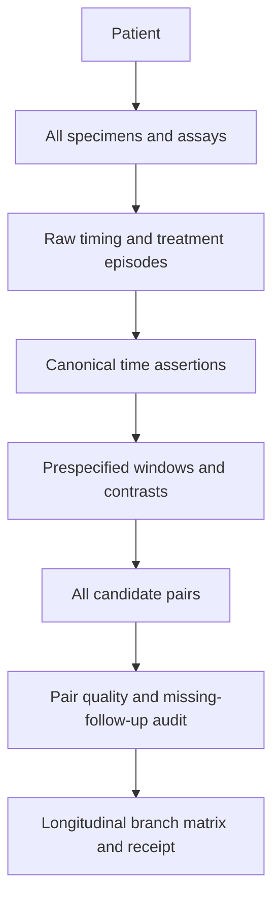

# Longitudinal pairing contract

## Authoritative long form

`patient_timepoint_long.tsv` preserves every patient × specimen × assay × timepoint. No follow-up row is discarded merely because a later row exists.

## Pair row grain

`longitudinal_pair_matrix.tsv` has one row per patient × prespecified contrast/window × branch version.

Required fields include:

```text
patient/study
response group and original endpoint
regimen/treatment episode
pre and follow-up specimen/assay IDs
pre and follow-up days/categories
same lesion/platform/measurement scale
pair-quality state
contrast/window ID
inclusion/exclusion and missing-follow-up reason
admission receipt ID
```

## Pair construction

1. identify the index treatment episode;
2. enumerate all eligible pre specimens;
3. enumerate all follow-up specimens with chronology and treatment state;
4. assign follow-ups to declared windows;
5. apply deterministic within-window selection or retain repeated measures according to the branch contract;
6. evaluate lesion, platform and scale comparability;
7. record excluded candidates and reasons;
8. emit pair and receipt.

The last observed row is never a selection rule. Row order must not change the output.

## Pair-quality states

- `HIGH`: verified patient, chronology, window, compatible assay/scale and no disqualifying regimen change;
- `MODERATE`: verified pair with a declared difference such as lesion or platform that the analysis can model;
- `LOW`: material limitation; sensitivity-only if explicitly allowed;
- `BLOCKED`: identity, chronology, endpoint or treatment state unresolved.

## Missing follow-up

Record whether follow-up was:

- not scheduled;
- scheduled but not collected;
- failed QC;
- inaccessible lesion;
- progression/death before biopsy;
- treatment discontinued;
- regimen changed;
- unavailable for unknown reason.

Complete-pair inference is conditional on re-biopsy/evaluability unless an analysis explicitly addresses missingness.

## Longitudinal matrix flow



## Failure states

```text
PAIR_IDENTITY_UNRESOLVED
NO_PRE_INDEX_SPECIMEN
NO_FOLLOWUP_IN_WINDOW
CHRONOLOGY_CONFLICT
MULTIPLE_FOLLOWUPS_NO_RULE
AFTER_REGIMEN_CHANGE
PROGRESSION_MIXED_WITH_SCHEDULED_ON
MEASUREMENT_SCALE_INCOMPATIBLE
ROW_ORDER_DEPENDENCE
```
