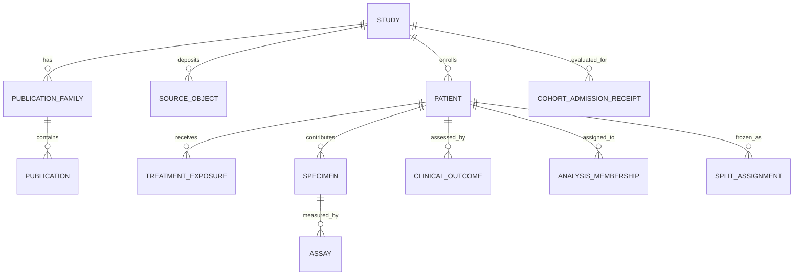

# Normalized patient data model

## Principle

The authoritative store is normalized. Branch-specific matrices are materialized views with receipts. No giant spreadsheet is the source of truth.

## Entities and keys

| Entity | Primary key | Row grain | Public status |
|---|---|---|---|
| study | `study_id` | one originating study/trial/cohort | patient-free record may be public |
| publication family | `publication_family_id` | one originating family | public |
| publication | `publication_id` | one paper/correction/reanalysis | public |
| source object | `source_object_id` | one exact retrievable object | metadata public when permitted |
| patient | `patient_uid` | one unique patient in one originating study | private |
| treatment exposure | `treatment_exposure_id` | patient × treatment episode/component | private |
| specimen | `specimen_uid` | one biological collection | private |
| assay | `assay_uid` | one assay/aliquot/processed measurement | private; aggregate public |
| clinical outcome | `outcome_id` | patient × endpoint assessment | private |
| overlap edge | `overlap_edge_id` | one typed node relationship | aggregate public; patient edges private |
| prior exposure | `exposure_id` | source/object/patient-set × previous use | aggregate public where safe |
| analysis membership | `membership_id` | patient × branch × version | private |
| split assignment | `split_assignment_id` | patient × split version | private |
| validation receipt | `validation_receipt_id` | gate evaluation | public if patient-free |
| admission receipt | `admission_receipt_id` | study × branch × version | public aggregate |
| matrix receipt | `matrix_build_receipt_id` | matrix × version | public aggregate |

## Normalized data model



## Patient UID

A patient UID is a stable project pseudonym. The raw-to-project alias table and any pseudonymization secret remain private. The public repository may contain only aggregate counts and synthetic IDs.

## Treatment exposure

One patient can have multiple episodes and multiple components per regimen. Prior ICI, prior systemic therapy, radiotherapy and concomitant immunosuppression are separate assertions with evidence and certainty.

## Specimen

A specimen stores exact collection time, biological compartment, lesion/site, recurrence state, preservation, biopsy method and selection reason. Same patient does not imply same lesion or same specimen.

## Assay

An assay stores source sample ID, source object, matrix header, modality, platform, feature annotation, unit, transform, processing history, replicate status, QC and branch suitability.

## Outcome

Each assessment remains an instance. A patient can have best overall response, PSA response, PFS and OS without one overwriting another.

## Assertions and provenance

Derived fields such as canonical time or endpoint mapping are assertions with:

```text
rule_id
rule_version
source locator
evidence type
confidence
reviewer
created UTC
supersedes/superseded_by
```

## Integrity constraints

- every patient belongs to exactly one originating study;
- every specimen belongs to exactly one project patient;
- every assay belongs to exactly one specimen and source object;
- every endpoint belongs to exactly one patient and assessment framework;
- every branch membership references a passed admission receipt;
- every split assignment references one immutable split version;
- no raw identifier is required in a public receipt.
