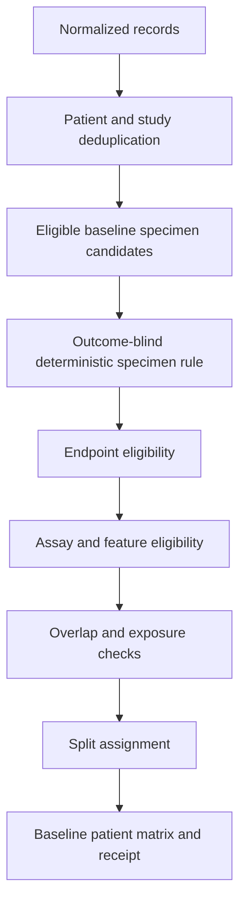

# Patient-matrix contract

## Principle

Materialized matrices are branch-specific, immutable products derived from the normalized registries. They never become the authoritative identity store.

## Baseline patient matrix

`baseline_patient_matrix.tsv` has one row per eligible patient for one named branch and version. It contains the selected baseline specimen and assay, original/canonical endpoint, treatment context, split role, exposure state and receipt IDs.

### Baseline selection hierarchy

A source-specific, outcome-independent rule is frozen before modelling. The general hierarchy is:

1. source-verified pre-index-treatment tumour specimen;
2. closest collection before index treatment;
3. prespecified biological compartment and lesion policy;
4. branch-compatible assay with source-supported QC;
5. biological specimen over technical resequencing;
6. deterministic tie rule independent of endpoint and model performance.

Multiple candidate baselines and the reasons for selection/exclusion are retained.

## Other matrices

- `patient_timepoint_long.tsv`: patient × specimen × assay × timepoint;
- `longitudinal_pair_matrix.tsv`: patient × declared contrast/window;
- `endpoint_matrix.tsv`: patient × endpoint instance;
- `assay_feature_coverage.tsv`: assay × required feature/programme;
- `split_registry.tsv`: patient × split version;
- `analysis_membership.tsv`: patient × branch × version.

## Common invariants

- all identifiers resolve to normalized registries;
- patient counts, specimen counts and assay counts are separate;
- no duplicate branch row at the declared grain;
- no patient enters a matrix without a passed admission receipt;
- no matrix uses a source object lacking a complete retrieval/validation state;
- missing values remain missing;
- exclusions are reason-coded and reproducible;
- matrix builds do not inspect model performance;
- previous matrix versions are never overwritten.

## Baseline matrix flow



## Matrix build receipt

Every matrix records:

```text
matrix ID and branch
schema/build version
source admission receipts
patient/specimen/assay/class/timepoint counts
exclusions and reasons
duplicate/overlap checks
feature coverage and missingness
split version
input/code/config/output hashes
build timestamp
test and validation status
```

## Failure states

```text
MATRIX_GRAIN_DUPLICATE
UNRESOLVED_IDENTIFIER
UNADMITTED_SOURCE
BASELINE_SELECTION_AMBIGUOUS
ENDPOINT_NOT_EVALUABLE
ASSAY_UNSUPPORTED
FEATURE_COVERAGE_FAILED
SPLIT_NOT_FROZEN
HASH_OR_VERSION_MISMATCH
```
