# Validation framework

## Gate model

Gate results are scoped to entity/study, branch and version. Status values are:

- `PASS`;
- `FAIL`;
- `BLOCKED_UNKNOWN`;
- `NOT_APPLICABLE`;
- `SUPERSEDED`.

A Boolean `usable` field is prohibited.

## Validation gates

| Gate | Meaning | Minimum evidence |
|---|---|---|
| V0 | candidate discovered | query/source locator; no eligibility claim |
| V1 | original study resolved | originating study, publication family and aliases |
| V2 | source object verified | exact object, filename/version and access route; hash after retrieval |
| V3 | measurement verified | modality/platform/unit/transform/IDs and structural checks |
| V4 | patient/specimen linkage verified | source-supported identity and replicate handling |
| V5 | endpoint, treatment and timing verified | patient-level clinical/timing evidence and mapping rules |
| V6 | overlap and prior exposure resolved | overlap graph and exposure ledger disposition |
| V7 | branch admission approved | versioned admission receipt |
| V8 | matrix build verified | immutable matrix receipt and structural validation |
| V9 | split/freeze approved | disjointness/exposure checks and release signature |

## Validation gates

```mermaid
flowchart LR
    V0[V0 candidate] --> V1[V1 study resolved]
    V1 --> V2[V2 object verified]
    V2 --> V3[V3 measurement verified]
    V3 --> V4[V4 identity linked]
    V4 --> V5[V5 endpoint timing treatment verified]
    V5 --> V6[V6 overlap exposure resolved]
    V6 --> V7[V7 branch admitted]
    V7 --> V8[V8 matrix verified]
    V8 --> V9[V9 split freeze approved]
```

## Readiness levels

| Level | Meaning |
|---|---|
| R0 | conceptual source lead |
| R1 | study/publication metadata resolved |
| R2 | exact processed object available |
| R3 | patient/specimen mapping validated |
| R4 | endpoint/timing/treatment validated |
| R5 | branch admission approved |
| R6 | branch matrix built |
| R7 | matrix structurally validated |
| R8 | split/freeze approved |
| R9 | released for the named scientific analysis |

Readiness is branch-specific. A file download is not analysis readiness. Synthetic tests do not validate a biological dataset.

## Validation receipt

Every gate receipt records subject, branch, gate/version, checks, status, reason codes, evidence locators, object/code/config hashes, validator, reviewer and timestamp. Failed checks remain visible in superseding receipts.

## Fail-closed conditions

- unknown measurement scale;
- ambiguous patient/specimen link;
- undefined endpoint;
- timing based only on row order;
- multiple follow-ups without a rule;
- unresolved material overlap for an independence claim;
- restricted data in a public output;
- unknown prior exposure when untouched status is claimed;
- missing object or code/config hash in a frozen release.

## Real-source tracer boundary

A small public tracer can validate parser and provenance assumptions. It cannot establish cohort admission, effect validity or biological reproducibility. Source-specific full validation remains required.
