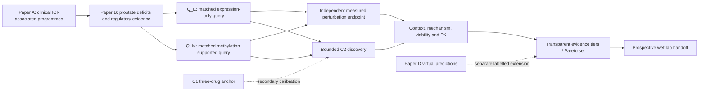

# Paper C scientific revision — approved framework, proposed endpoint

15 October 2026 · **APPROVED FRAMEWORK** · **PROPOSED PRIMARY** · **NO BIOLOGICAL RUN AUTHORIZATION**

Baseline: `a8278c776da7c6b096cc14139d729979db286b50` on `main`.

The user approved the following scientific architecture:

- **C3** is the Paper C framework: evidence-based experimental prioritisation;
- **C2** is a bounded, identity-curated perturbation discovery screen;
- **C1** is secondary calibration, not the primary;
- the paired independent-measured `Q_M` versus `Q_E` endpoint is developed as the proposed primary.

The controlling decision is [C_FRAMEWORK_20261015.md](../../../docs/decisions/C_FRAMEWORK_20261015.md). This folder converts that decision into a reviewable specification kit. It does not report perturbation effects, nominate a winning drug, or release production analysis.

## Scientific question

> Do clinically anchored prostate immune-barrier genes supported by patient methylation evidence show greater desired-direction molecular responsiveness to independently measured epigenetic perturbations than a matched expression-only query, and which interventions remain credible after cellular context, mechanism, viability and pharmacology are considered?

## Reading order

1. [Scientific Revision Report](../../../docs/research/C_SCIENTIFIC_REVISION_20261015.md)
2. [Scientific scope](SCIENTIFIC_SCOPE.md) and [protocol crosswalk](PROTOCOL_CROSSWALK.md)
3. [Data/source contract](DATA_SOURCE_CONTRACT.md) and [source-role manifest](manifests/source_roles.tsv)
4. [B-to-C query handoff](QUERY_HANDOFF.md)
5. [Drug universe and identity](DRUG_UNIVERSE.md)
6. [Primary analysis contract](ANALYSIS_CONTRACT.md)
7. [LINCS and numerical scorer contract](SCORER_CONTRACT.md)
8. [Exposure and cellular context](EXPOSURE_CONTEXT.md)
9. [Validation architecture](VALIDATION_ARCHITECTURE.md)
10. [Evidence integration](EVIDENCE_INTEGRATION.md), [pharmacology](PHARMACOLOGY.md) and [wet-lab handoff](WETLAB_HANDOFF.md)
11. [Four-figure plan](FIGURES.md)
12. [Software architecture](SOFTWARE_ARCHITECTURE.md), [implementation tickets](tickets/IMPLEMENTATION_TICKETS.md) and [readiness](IMPLEMENTATION_READINESS.md)
13. [Preregistration/decision ledger](PREREGISTRATION_DECISIONS.md) and [unresolved questions](UNRESOLVED_QUESTIONS.md)
14. [References and novelty comparison](NOVELTY.md), [references](REFERENCES.md) and [validation audit](../../../docs/validation/C_scientific_revision_20261015/AUDIT.md)

## Authority and status

The framework choice is approved. The exact biological primary is **proposed, not frozen for execution** until all required query, source and measurement gates close. The old files directly under `specs/C/` remain historical evidence and reusable engineering material; where they conflict with the approved framework, the dated decision above controls after merge.

`UNKNOWN` is a required state. It is never permission for an implementer to guess a dose, replicate count, control, formulation, regulatory status, source overlap or biological result.

The arrows transfer evidence. They do not identify clinical treatment benefit.
