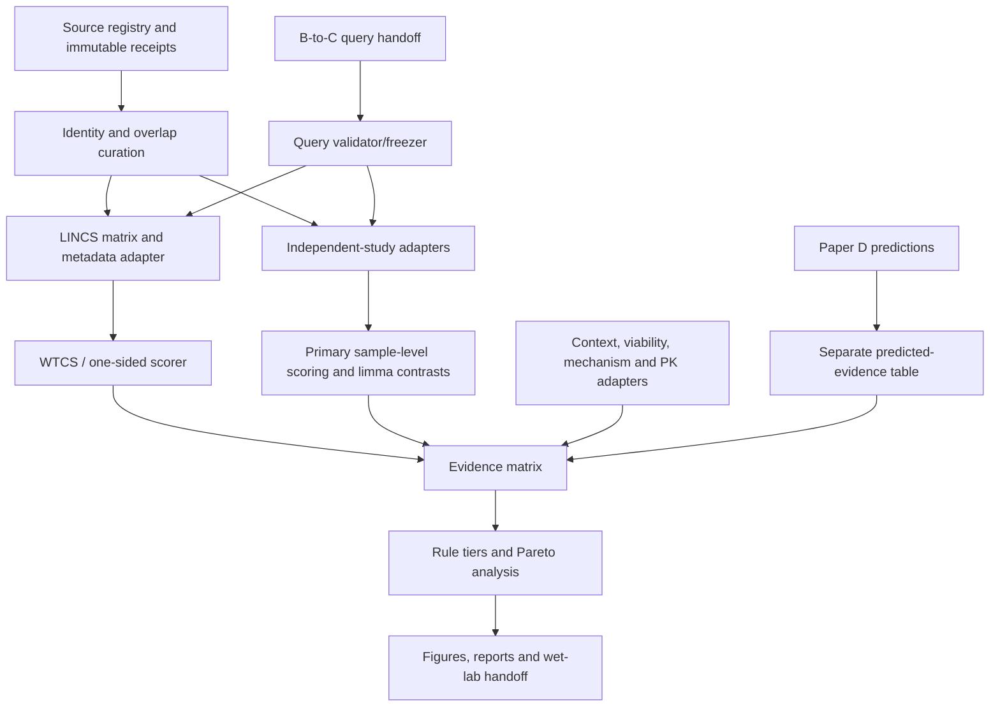

# Software architecture and reuse plan

## Architecture

## Component disposition

| Component | Current state | Action |
|---|---|---|
| Existing source/provenance patterns | Reusable | Adapt |
| LINCS metadata audit scripts | Real-metadata audited | Reuse and harden |
| Compound identity curation | Partial | Extend to parent/salt/structure/status |
| GCTX/matrix adapters | Incomplete for production | Implement with ID/hash gates |
| WTCS scorer | Specification/synthetic only | TDD and official parity |
| Tau | Missing exact reference path | Do not implement by approximation |
| B-to-C query interface | Proposed, B not frozen | Implement schema/validator first |
| Independent-study adapters | Source-specific gaps | One adapter per admitted study |
| Sample-level primary scorer | New | Implement pinned directional rank scoring |
| Limma contrast engine | New/reusable R patterns | Implement source-aware designs |
| Viability/context adapters | Proposed | Preserve native scales |
| PK extraction | Missing production module | Structured records from primary sources |
| Evidence integration | Missing | Implement matrix, tiers and Pareto set |
| Reporting/provenance | Existing patterns | Extend |
| Restart/resume | Existing patterns | Reuse with stage receipts |

## Package boundaries

Suggested implementation modules after scientific release:

- `paper_c/contracts/`
- `paper_c/sources/`
- `paper_c/identity/`
- `paper_c/queries/`
- `paper_c/scoring/`
- `paper_c/validation/`
- `paper_c/context/`
- `paper_c/pharmacology/`
- `paper_c/integration/`
- `paper_c/reporting/`

Do not create these production modules merely because the documentation branch exists. The implementation tickets specify release gates.

## Provenance requirements

Every stage writes:

- input object hashes;
- code/configuration identity;
- environment versions;
- exact command and timestamps;
- admitted/excluded counts with reasons;
- output hashes;
- warnings/failures;
- completion state distinguishing synthetic, smoke, primary and validation runs.

Credentials, restricted data and large matrices remain outside Git.
